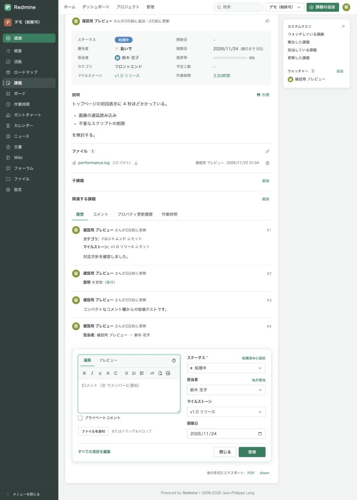
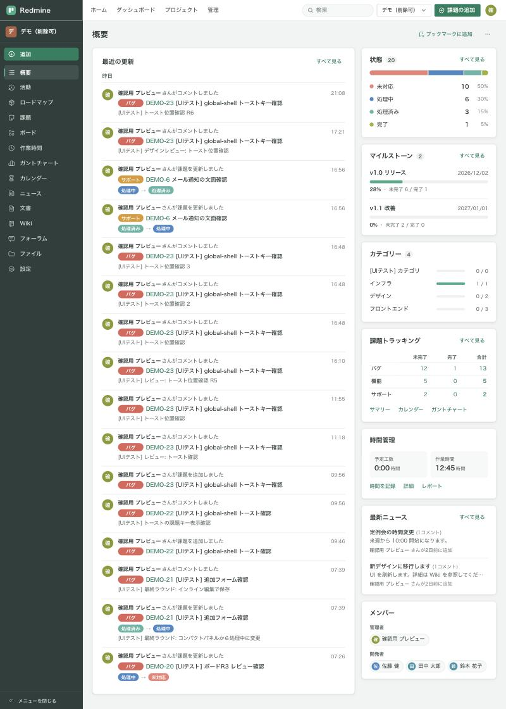
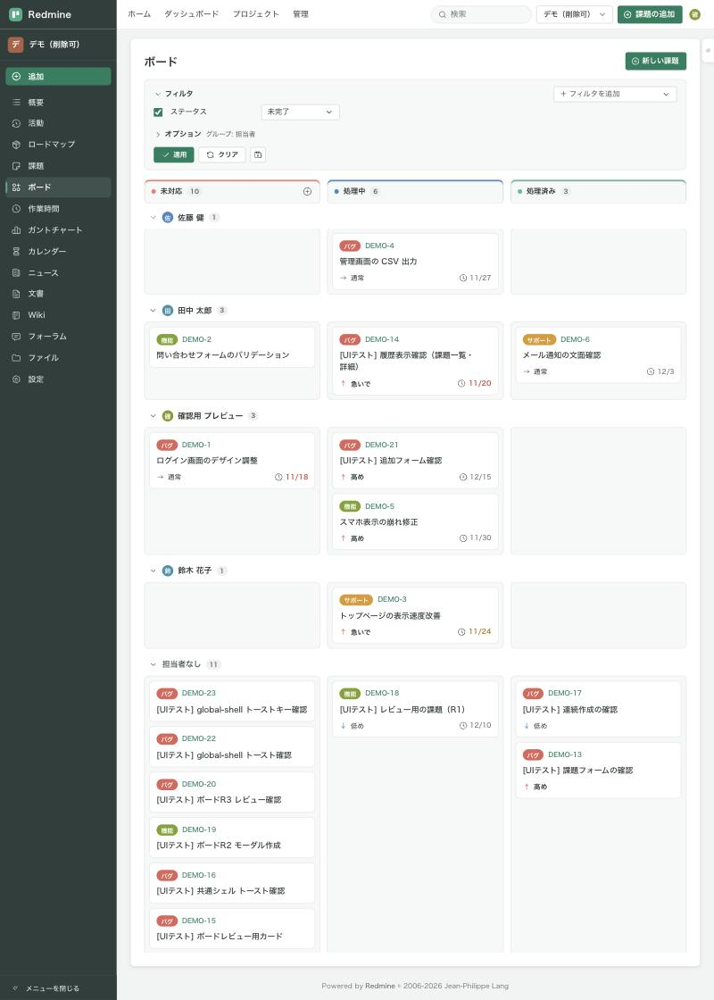
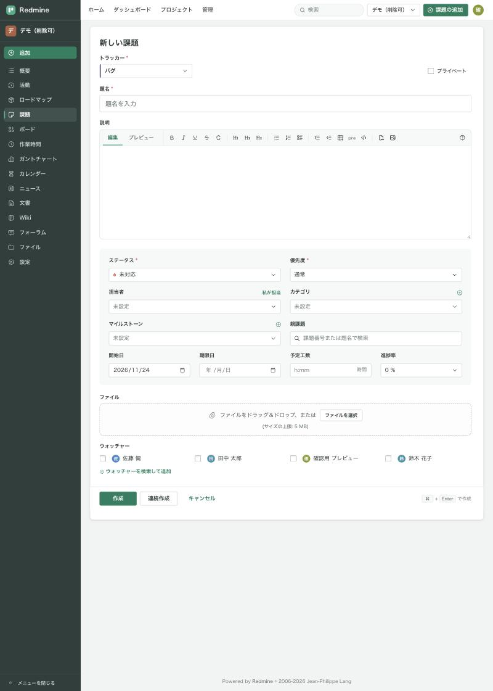
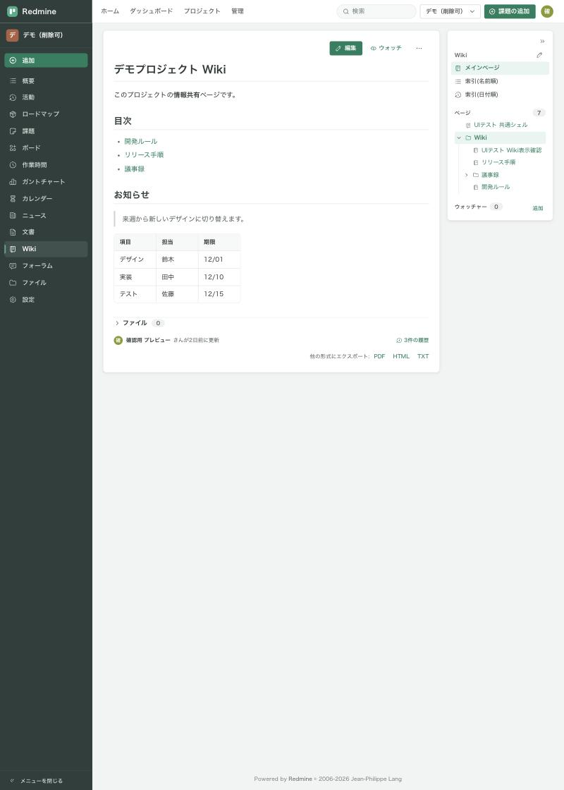

# Greenboard — Redmine テーマ

Redmine 6 を、すっきりした緑基調のカード型 UI に作り替えるテーマです。
課題の追加・編集をシンプルなフォームにし、コメントは編集モードに入らずに書けます。
カンバン（ボード）、ダッシュボード、プロジェクトホームも使いやすく整えています。

> 本テーマは、Backlog のような日本のプロジェクト管理ツールの使い勝手を参考にした独自のデザインです。
> Backlog（株式会社ヌーラボ）とは関係がなく、同社のロゴ・アイコン・画像などの素材は一切含みません。



| プロジェクトホーム | ボード |
|---|---|
|  |  |
| 課題の追加 | Wiki |
|  |  |

スマホ幅（375px）にも対応しています（`docs/screenshots/m02-issues.jpg`、`m05-board.jpg`）。

## 構成

| パス | 内容 |
|---|---|
| `themes/greenboard/` | テーマ本体（ビルド済み）。Redmine の `themes/` に置きます |
| `plugins/redmine_greenboard/` | テーマ用の小さなプラグイン（ダッシュボードのブロック、プロジェクトホームの表示、用語の言い換え、既定値） |
| `src/` | テーマのソース（部品ごとの CSS / JS）と `build.sh` |
| `docs/` | デザイン仕様（`DESIGN.md`）、部品の担当表（`COMPONENTS.md`）、スクリーンショット |
| `docker/` | Docker で試すための例（`Dockerfile`、`compose.example.yaml`、`.env.example`） |

## 必要なもの

- Redmine 6.0 以上（6.1 で確認）
- ボード（カンバン）を使う場合: [redmine_issues_panel](https://github.com/redmica/redmine_issues_panel)（v1.2.2 で確認）
- テーマだけでも見た目は変わりますが、ダッシュボードのブロックや用語の言い換え（チケット→課題、バージョン→マイルストーン など）は
  `redmine_greenboard` プラグインが必要です

## インストール

1. `themes/greenboard` を Redmine の `themes/` に、`plugins/redmine_greenboard` を `plugins/` にコピーします。
2. （ボードを使う場合）`redmine_issues_panel` を `plugins/` に入れます。
3. Redmine を再起動します（プラグインのマイグレーションは不要です）。
4. 管理 → 設定 → 表示 → テーマ で「Greenboard」を選びます。

### Docker で試す

```bash
cp docker/.env.example docker/.env   # DB_PASSWORD と SECRET_KEY_BASE を設定する
docker compose -f docker/compose.example.yaml up -d --build
```

`http://localhost:3000` を開き、管理者でログインしてテーマを選んでください。

## 推奨設定

このテーマは、次の設定を前提に作っています（必須ではありません）。

- ステータス名: 未対応 / 処理中 / 処理済み / 完了
- ユーザー名の表示形式: 「姓 名」
- 言語: 日本語

## ソースからビルド

```bash
./src/build.sh
```

`src/css/*.css` と `src/js/*.js` をファイル名順に連結して、`themes/greenboard/` に書き出します。
共通部品（`15-c-*`）は 1 か所にだけ実装し、ページごとのファイルではレイアウトだけを指定する方針です（`docs/COMPONENTS.md`）。

## ライセンス

GNU General Public License v2.0（Redmine と同じ）。`LICENSE` を参照してください。
アイコンは Redmine 本体のアイコンスプライトを使用しています。
